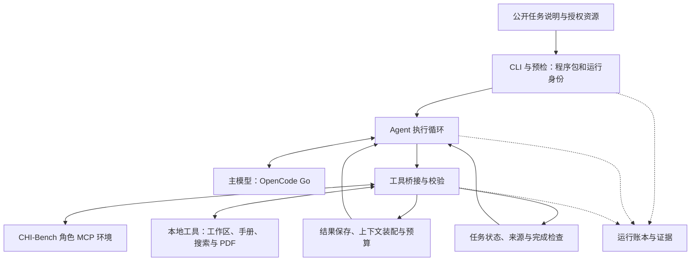

# CHI Workflow Agent

**面向 CHI-Bench 的医疗行政工作流 Agent。**

支持医疗机构授权申请（Provider）、保险方审查（Payer）和照护管理（CM）。模型根据任务说明和可观察的业务事实选择行动，通过官方 MCP 工具操作业务环境；程序负责上下文预算、工具调用校验、完成核验和可追溯的运行记录。

[项目背景](#项目背景) · [业务场景](#业务场景) · [核心能力](#核心能力) · [整体架构](#整体架构) · [任务流程示例](#任务流程示例) · [快速开始](#快速开始) · [验证与阶段成果](#验证与阶段成果) · [项目结构](#项目结构) · [文档导航](#文档导航)

## 项目背景

[CHI-Bench](https://github.com/actava-ai/chi-bench) 提供医疗行政工作流的任务和工具环境。任务需要 Agent 查询业务记录、阅读适用规则、准备材料、执行操作，并确认操作后的状态。不同任务可能需要提交申请、补充材料、作出审查决定，或完成患者联络与照护计划。

这类任务的难点贯穿整个执行过程：

- **信息分散且持续增长**：病历、政策、PDF 和工具结果需要按需读取，长历史还会占用模型上下文。
- **动作存在业务前置条件**：患者和案件要对应，表单与材料要齐备，决定和通知要一致。
- **写入结果需要确认**：请求超时后，业务操作可能已经生效；直接重试可能造成重复提交。
- **完成结论需要证据**：模型的最终回答、工具返回、业务状态和官方评测结论需要分别记录。

本项目围绕这些问题实现 Agent 运行与交付层。单次运行选择一个业务角色，连接对应的官方 MCP 服务，并使用该角色获准访问的工作区和资源。开发与调度使用 **Python 3.12 + Docker**，模型执行循环使用 OpenAI Agents SDK。

文中的 **Go** 指 OpenCode Go 模型调用路径。

## 业务场景

| 角色 | 典型工作 | 执行时关注的条件 |
| --- | --- | --- |
| Provider：医疗机构授权申请 | 定位患者和医嘱，核对病历与适用规则，填写表单、整理证据、提交授权申请 | 患者身份唯一确认，申请内容有来源支持，提交前检查材料，提交后回读案件状态 |
| Payer：保险方审查 | 读取入件与附件，评估条款，记录决定，按要求进行医生审查、医师间沟通（P2P）或通知处理 | 批准、部分批准、拒绝、待补件和转交均需由观察到的规则与事实支持；后续信函与决定一致 |
| CM：照护管理 | 接收转介、审阅病历、开展患者联络、保存评估、编制与完成照护计划 | 尊重患者联系偏好与停止联系（STOP）要求；同意参与后继续完成任务要求的评估和计划；保留患者陈述与病历事实的来源区别 |

三类场景的阶段指导见 [role_guidance.py](src/chi_agent/roles/role_guidance.py)。实际分支由公开任务说明、规则和工具返回决定。

## 核心能力

### 带来源的任务状态

将任务目标、观察事实、计划、缺口、业务写入和未知结果分别保存。状态中的事实需要引用本次运行实际返回的工具调用；角色阶段指导帮助模型检查当前进度和下一步条件。

实现入口：[任务状态](src/chi_agent/agent/task_state.py) · [角色指导](src/chi_agent/roles/role_guidance.py)。

### 有预算的上下文管理

工具层对大结果进行裁剪或分页，并保存完整结果供后续读取。请求装配层根据预算组织历史，压缩重复和较旧的只读结果，同时保留业务写入的规范记录。上下文上限、输出预留和实际用量分别记录，便于检查预算与请求之间的关系。

实现入口：[上下文装配](src/chi_agent/context/context_assembly.py) · [预算计算](src/chi_agent/context/context_budget.py)。LLM 输入摘要和输出截断恢复是显式可选策略，默认关闭。

### 工具调用与提交前校验

在派发前检查工具参数和允许访问的路径，约束角色工作区中的文件操作。Provider 路径进一步核对患者绑定、已交付的病历观察和提交前材料审阅，阻止缺少必要依据的提交。

实现入口：[MCP 桥接](src/chi_agent/tools/mcp_tools.py) · [本地工具](src/chi_agent/tools/local_tools.py) · [患者绑定](src/chi_agent/roles/patient_identity_binding.py)。Provider 的具体约定见[提交前检查规格](openspec/specs/provider-pre-submission/spec.md)。

### 基于业务回读的完成检查

通过 `local-completion-check` 检查已记录的业务写入、回读、失败和未决状态，再由 `local-claim_done` 记录完成声明。当前 `chi-context-v3` 路径要求显式声明完成；缺少必要回读或存在未解决的写入结果时，会阻止声明。

这套检查验证机械条件和证据关联。业务判断是否正确、任务要求是否在语义上全部满足，以及官方评分，仍需要各自的验证。

实现入口：[完成检查](src/chi_agent/agent/completion.py) · [任务状态与完成报告](src/chi_agent/agent/task_state.py)。

### 故障处理与运行账本

模型请求、工具事件、用量、费用明细和未知状态保留在运行记录中。Go 路径关闭自动重试，新出现的请求结果或用量未知会停止后续模型调用；业务写入效果未知时，状态检查阻止继续写入或直接声明完成。

已实现的输出截断恢复策略需要显式启用，按响应形态进行有界接续或重新生成，将原始响应与后续请求关联记录。历史检查使用对应的冻结包与账本，支持追查一次运行使用了什么代码、配置和证据。

实现入口：[请求守卫](src/chi_agent/models/opencode_go_provider.py) · [运行账本](src/chi_agent/accounting/journal.py) · [输出恢复](src/chi_agent/context/output_recovery.py)。

### 可复现的交付与离线回放

将运行代码、启动入口、依赖锁和文件摘要导出为独立程序包，用清单校验包身份。离线回放以合成模型响应和 MCP 事件驱动真实执行循环，记录工具派发、状态和完成声明，并报告首个分歧。

实现入口：[程序包构建](src/chi_agent/bundle.py) · [回放与比较](scripts/tools/replay_trace.py)。

## 整体架构



模型在执行循环中选择工具，工具桥接层检查并派发调用，返回结果再进入状态记录与下一轮上下文。官方 MCP 环境负责业务操作；本地工具负责读取授权资源、维护任务状态和保存交付文件。账本记录包身份、请求和工具事件，供之后核对。

当前 Go 入口的主要默认配置如下，具体策略随冻结程序包记录：

| 配置 | 默认行为 |
| --- | --- |
| 主模型 | 经 OpenCode Go 调用 `deepseek-v4.1-flash` |
| 上下文策略 | `chi-context-v3` |
| 主请求输出上限 | `8192`，可用 `--main-max-tokens` 显式覆盖 |
| 输入摘要 / 输出截断恢复 | 均关闭；启用时需满足对应策略的组合限制 |
| 逐项需求声明门禁 | `--requirements chi-requirements-v1` 可选，默认关闭 |
| 自动重试 | `0` |
| 费用策略 | `record_only`，记录费用与缺失明细；该模式不设置美元硬上限 |

源码入口：[CLI](src/chi_agent/cli.py) · [执行循环](src/chi_agent/agent/runtime.py) · [固定策略](src/chi_agent/agent/runtime_policy.py)。

## 任务流程示例

以下以一个**合成的 Provider 授权申请场景**说明执行过程。步骤用于解释各层职责，实际动作取决于任务说明和当次观察。

1. **接收任务与预检**：核对程序包、运行身份、输入文件和资源路径，连接 Provider MCP 服务。
2. **确认目标**：模型查询候选患者、病历和医嘱，结合任务中的线索确认唯一患者，再绑定相关案件。
3. **整理依据**：读取病历、政策与所需表单，将关键事实和缺失材料按来源记录到任务状态。长文档通过搜索、分页和重读获取。
4. **准备申请**：生成或填写材料，保存到角色工作区，检查表单和证据包，并完成提交前审阅。材料不足时记录缺口与处置理由。
5. **执行与回读**：具备条件后调用官方提交工具，再读取目标案件或授权状态。写入效果未知时保留未知状态，等待查证。
6. **检查与报告**：执行完成检查，满足机械条件后记录完成声明，输出运行结果、交付文件和可追溯记录。

运行日志包含 `run_log.txt`，任务状态保存在日志目录的 `task-state/` 下。它们与模型请求、工具事件和程序包身份一起用于开发复盘。

## 快速开始

### 1. 构建镜像与导出程序包

需要 Docker Engine 和 Docker Compose。以下命令在源码仓库根目录执行，Python 和项目依赖安装在容器内。

```sh
docker compose build dev
docker compose run --rm --no-deps dev python -m chi_agent.bundle build --target /workspace/dist
docker compose run --rm --no-deps dev python -m chi_agent.bundle verify --root /workspace/dist
```

`dist/` 必须是尚不存在的目录。构建结果包含 `manifest_sha256`，验证时检查清单与文件内容是否一致。上述命令完成镜像构建、程序包导出和清单验证，无需模型 Key。

| 导出内容 | 用途 |
| --- | --- |
| `scripts/go_chi_entry.py` | 预检、模型工具调用准入（coding B）、任务运行和历史检查入口 |
| `scripts/chi_agent/` | 按职责子包组织的运行代码 |
| `bundle-manifest.json` | 文件摘要和程序包身份 |
| `requirements-model.lock` / `requirements-pdf.lock` | 模型 SDK 与 PDF 依赖锁 |

### 2. 准备运行资源并预检

执行任务还需要调用方在包外准备：

- 固定到 `4444a07fa68a4f1623f841a292a54e284fc8e7f7` 的 CHI-Bench 源码，以及对应角色的业务环境。
- 按程序包依赖锁安装的模型 SDK 与 PDF 依赖。
- 公开任务说明、工具参考、已获授权的手册和角色工作区。
- 可写的外部状态及日志目录；真实模型调用由运行进程通过环境变量接收 `OPENCODE_API_KEY`。

按 [Go 运行手册](docs/go-chi-entry-runbook.md) 完成依赖准备和隔离预检，成功时返回 `identity_verified`。每个包身份需要先取得自己的 coding B 收据，再按相应授权运行任务。包身份校验用于确认文件与配置，候选准入及真实调用仍按各自审批执行。

另有[兼容评测程序包](docs/evaluation-entry-runbook.md)，支持计划、预检和合成演练；该路径当前的 `live` 返回 `real_execution_paused`。两种程序包的入口与运行条件分别以各自手册为准。

## 验证与阶段成果

### 开发运行覆盖

已核对至少 **20 个不同公开任务**存在真实模型开发运行记录：

| 角色 | 已核对的不同任务数 |
| --- | ---: |
| Provider | 10 |
| Payer | 6 |
| CM | 4 |

这些记录来自各自的冻结版本。其中 Go 的 17 个任务各有至少一次 `complete + claim`，早期 DeepSeek 直连的另外 3 个 Provider 任务有 `completed_ungraded` 记录。数量用于说明开发覆盖，不构成同一候选版本的通过率。

最近一组主请求输出上限为 `16384` 的开发基线覆盖 Payer t022、t023、t024 和 CM anorexia、CKD、asthma。六题均记录完成声明，`inspect_history` 返回 `inspected`。各结果的 **`official_reward=null`**，历史检查说明记录可核对，官方评分仍待验证。

任务列表、原始证据入口、冻结版本和当前未决项见[审核接续状态](openspec/REVIEW_STATE.md)。Harbor 真实模型 Trial 与最终配送仍待验证。

### 离线回归与程序包检查

准备好固定版本的 vendor 源码、开发及 controller 镜像、模型与 PDF 依赖卷后，运行：

```sh
CHI_VENDOR_DIR=/absolute/path/to/pinned/chi-bench bash scripts/tools/verify_offline.sh
```

[验证脚本](scripts/tools/verify_offline.sh) 在禁用网络、源码只读挂载的 Docker 容器中运行测试、检查导入、验证两种程序包及包外预检。默认要求工作区干净；检查未提交的文档或代码时可传入 `--allow-dirty`。镜像和依赖卷的覆盖变量见脚本。

### 离线合成轨迹回放

当前回放套件使用合成的 Payer 模型响应和 MCP 事件，验证工具调用、错误处理、状态与完成声明。按运行手册准备好固定版本的 CHI-Bench 源码及依赖卷后，可从源码根目录执行以下命令；源码路径和卷名需替换为调用方已经准备好的资源。

```sh
chi_replay_output=$(mktemp -d)
chi_vendor_dir=/absolute/path/to/pinned/chi-bench
docker run --rm --pull=never --network none --read-only --tmpfs /tmp \
  -e PYTHONDONTWRITEBYTECODE=1 \
  -e PYTHONPATH=/model-deps:/pdf-deps:/vendor/chi-bench/src:/workspace/src:/workspace \
  -v "$PWD:/workspace:ro" -v "$chi_replay_output:/out:rw" \
  -v "$chi_vendor_dir:/vendor/chi-bench:ro" \
  -v chi-h-root-model-deps-20261027-v1:/model-deps:ro \
  -v chi-k-pdf-deps-20261027-v1:/pdf-deps:ro \
  -w /workspace chi-agent-dev:latest sh -ec '
    python -m scripts.tools.replay_trace run --suite tests/fixtures/trace_replay_suite.json --output-dir /out/replay-baseline
    python -m scripts.tools.replay_trace run --suite tests/fixtures/trace_replay_suite.json --output-dir /out/replay-candidate
    python -m scripts.tools.replay_trace compare --baseline /out/replay-baseline/report.json --candidate /out/replay-candidate/report.json
  '
```

每次 `run` 必须使用尚不存在的输出目录。结果保存在 `$chi_replay_output` 下，各次 `report.json` 记录 `planned`、`passed`、`failed`、`not_executed`，并包含源码、回放器与依赖环境身份。

上例对同一份源码回放两次，用于检查复现与比较流程。比较不同候选时，应分别挂载对应版本，并保持套件、回放器和环境一致。合成回放验证执行路径，真实模型的业务表现与官方成绩需要另外评测。

## 项目结构

| 路径 | 用途 |
| --- | --- |
| [src/chi_agent/agent](src/chi_agent/agent/) | 执行循环、任务状态、完成核验与运行策略 |
| [src/chi_agent/context](src/chi_agent/context/) | 上下文装配、预算、输入摘要和输出恢复 |
| [src/chi_agent/tools](src/chi_agent/tools/) | MCP 桥接、本地文件与搜索、PDF 读取和工具契约 |
| [src/chi_agent/models](src/chi_agent/models/) | 模型适配、传输与请求守卫 |
| [src/chi_agent/accounting](src/chi_agent/accounting/) | 运行账本、用量、费用、证据和诊断 |
| [src/chi_agent/roles](src/chi_agent/roles/) | 三角色阶段指导、患者绑定和角色专用证据处理 |
| [src/chi_agent/evaluation](src/chi_agent/evaluation/) | 评测预检与模型运行适配 |
| [src/chi_agent](src/chi_agent/) 根目录 | CLI、两种程序包构建、配送与 Harbor 入口 |
| [scripts/development](scripts/development/) | 开发调度、资源检查和患者模拟 |
| [scripts/experiments](scripts/experiments/) | 早期探针、基线和实验 |
| [scripts/tools](scripts/tools/) | 构建、检查和运行汇总 |
| [tests](tests/) | 回归测试、合成工具环境与回放 fixture |
| [docs](docs/) | 程序包运行手册 |
| [openspec](openspec/) | 行为规格、变更设计、验收场景和审核接续状态 |

凭据、授权手册、任务数据、vendor checkout、原始账本和运行轨迹由调用方在本地提供，源码与程序包通过明确的挂载和资源路径访问它们。

## 文档导航

| 想了解什么 | 阅读入口 |
| --- | --- |
| 导出 Go 程序包、准备依赖、预检与运行 | [Go 运行手册](docs/go-chi-entry-runbook.md) |
| 兼容评测入口与合成演练 | [兼容评测手册](docs/evaluation-entry-runbook.md) |
| 已有开发证据、当前授权和未决事项 | [审核接续状态](openspec/REVIEW_STATE.md) |
| 目前纳入主规格的行为约定 | [OpenSpec 主规格](openspec/specs/) |
| 上下文管理的设计与取舍 | [上下文工程设计](openspec/changes/context-engineering/design.md) |
| 输出截断恢复与故障分层 | [输出恢复方案](openspec/changes/project-completion/output-recovery.md) · [故障分层设计](openspec/changes/failure-handling-layers/design.md) |
| 项目规划与历史变更 | [接续入口](openspec/competition-route.md) · [变更目录](openspec/changes/) |
| 参与开发时的流程约定 | [AGENTS.md](AGENTS.md) |

OpenSpec 变更目录包含活动计划与历史设计。阅读具体能力时，需结合代码、任务清单和审核状态核对交付范围；主规格与归档记录分别保留其已纳入的约定和变更历史。
