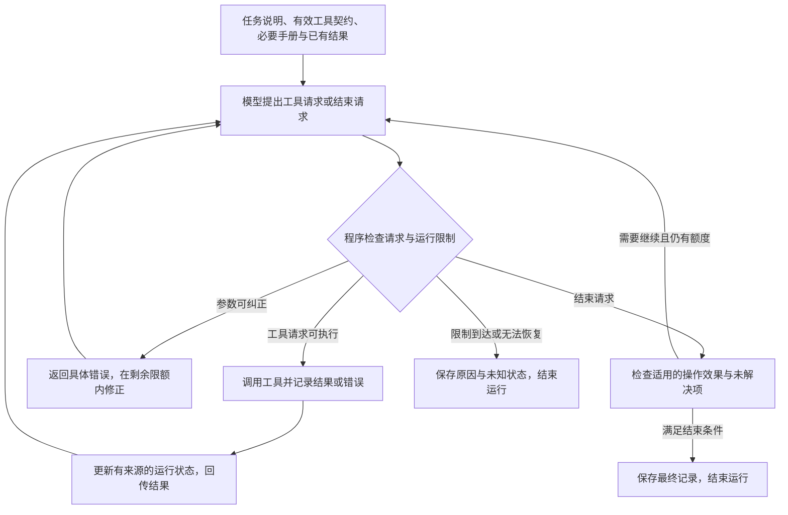

# Agent 执行循环：首版设计讨论

日期：2026-10-21（Asia/Shanghai）。状态：讨论草案，尚未冻结行为规格、选择 SDK 接入点或恢复编码/付费调用。讨论聚焦执行循环和运行状态，沿用 [开发准备](development-preparation-2026-10-21.md) 中暂缓本地官方评分的安排。

## 建议的基本形态

首版先用一个 Agent 执行一个任务，复用适配成功的官方模型/工具循环。模型根据当前信息提出下一步动作，程序负责接口派发、运行限制、状态与证据记录，并在结束前做有限检查。

这是一项设计建议，不表示已经实现了业务阶段控制器，也不保证能通过官方任务。模型的推理仍可能出错，程序检查只能覆盖明确可观察的条件；真正的竞赛通过由官方判分决定。

## 已核对的上游基础

源码固定于 `4444a07fa68a4f1623f841a292a54e284fc8e7f7`，只读学习副本在 `.coordination/upstream-reference/learning/`：

- `openai_agents_runner.py::run_agent`（637 行起）：取得模型配置，建立 MCP 连接，注册本地工具，创建 Agent，再调用 `Runner.run`，设置最大轮数并记录结果。未逐行阅读 SDK 的内部调度实现。
- 同文件 `SYSTEM_PROMPT` 是通用任务提示，包含根据工具结果继续行动、失败时重试和声明结束等说明，未编码所选医院侧任务的业务检查表。提示中存在询问用户的通用条款；不能据此允许正式 trial 中由人接管动作，竞赛自主运行要求优先。
- `openai_agents_local_tools.py::_on_claim_done` 仅返回一条完成标记字符串，没有查询业务状态或产生官方 reward。不能把调用此工具当作任务已通过的证据。

来源：[官方 runner](https://github.com/actava-ai/chi-bench/blob/4444a07fa68a4f1623f841a292a54e284fc8e7f7/src/chi_bench/experiment/agents/openai_agents_runner.py)、[官方本地工具](https://github.com/actava-ai/chi-bench/blob/4444a07fa68a4f1623f841a292a54e284fc8e7f7/src/chi_bench/experiment/agents/openai_agents_local_tools.py)。下面的状态、检查与恢复策略是拟议增量，不能标为官方现成功能。

## 每一轮怎样运行

模型收到的上下文包括任务、工具说明、需要的资料以及历史工具结果，并不是每轮都只收到最初问题。更准确地说，每轮需要显式提供当前决策所需的历史信息，不要求永久携带全部原文；模型不能读取未提供给它的本地记录。工具结果应按调用标识配对回传，避免把上一次操作的结果错配给下一次操作。上下文管理的首版建议见下节；具体阈值和自动摘要接入点仍需根据所选模型、接口和真实轨迹确定。

## 上下文管理与压缩：首版讨论

用户提出是否需要设计上下文压缩。建议现在确定信息保留原则，在真实基线中测量长度和成本，再决定是否增加整段历史的自动摘要。上下文管理属于 Agent 执行程序/runner 的职责，具体实现可以利用所选 SDK 的能力；不修改官方业务环境来实现，也不预设需要额外 Agent 或向量数据库。

后续讨论：用户已解释超时可能是服务端已执行、响应未收到；并提出参考 Codex。已完成 [Codex 公开压缩实现的核对与讲解](codex-context-compaction-study-2026-10-21.md)，区分普通摘要、服务端 V2 压缩项和 CHI 可借鉴的候选设计。没有选择具体压缩 API、阈值或恢复实现。

先区分三份内容，不能把“小型任务进度表”当成全部历史：

| 内容 | 用途 | 是否每轮全部发送 |
| --- | --- | --- |
| 本地执行档案：工具请求、原始返回、错误及证据文件 | 事后验收、追溯和按需读回 | 否；需要保留可访问的原文位置 |
| 小型任务进度表：实际 ID、已确认事实与来源、最新核实状态、材料缺口、结果不明的操作 | 在历史变长时保留关键进度与不确定性 | 建议提供当前版本，不能把摘要当成业务系统的权威记录 |
| 本轮模型输入：任务/约束、有效工具契约、进度、相关原文、近期完整工具往返及协议要求的字段 | 支持下一步决策 | 是；这才是本轮实际上下文 |

这张表描述拟议设计，不表示现有 runner 已完整保留所有原始载荷。固定源码 `_dump_trace` 在执行返回结果后整理轨迹；过长工具原文另存依赖相应逻辑成功执行，还没有验证崩溃时的完整记录。

### 官方参考 runner 已做什么

- `MAX_SINGLE_TOOL_RETURN_CHARS` 默认是 100,000 **字符**，不是 token 预算。
- `_truncate_or_spill`（202 行起）会尝试保存超长工具文本，再返回开头和文件指针；保存失败则退回原文。这是长度截断，不会判断重要内容是否在末尾。
- `_install_oversize_output_patch`（244 行起）将该策略接到可转为文本的 MCP 返回；补丁安装也可能失败，不能假定每个结果都受保护。
- `run_agent`（637 行起）调用 `Runner.run` 并限制轮数；这个接入层没有显式的整段历史滚动摘要或按 token 触发的压缩逻辑。未核对所选版本 SDK 的全部内部行为，不能据此断言 SDK 本身没有相关能力。

来源：[长度限制](https://github.com/actava-ai/chi-bench/blob/4444a07fa68a4f1623f841a292a54e284fc8e7f7/src/chi_bench/experiment/agents/openai_agents_runner.py#L111)、[保存超长结果](https://github.com/actava-ai/chi-bench/blob/4444a07fa68a4f1623f841a292a54e284fc8e7f7/src/chi_bench/experiment/agents/openai_agents_runner.py#L202)、[执行入口](https://github.com/actava-ai/chi-bench/blob/4444a07fa68a4f1623f841a292a54e284fc8e7f7/src/chi_bench/experiment/agents/openai_agents_runner.py#L637)。这些源码观察不能代替真实运行验证。

### 拟议顺序与保留原则

1. **先减少无关输入**：只读相关手册章节、病例片段及必要字段；接口支持时使用分页/范围读取。大结果保留原文位置，不反复灌入整份资料。不能因截取方便而漏掉适用条件或例外。
2. **保留可追溯的进度**：已完成的旧查询可整理为带来源的事实；实际 patient/order/case ID、关键数值与日期、否定条件、最新核实状态、材料缺口和结果不明的写操作不能因摘要消失。状态观察要能关联具体申请与操作，必要时保留时间；冲突或过期信息需重新查询。
3. **按模型输入预算组织请求**：计入任务、工具定义、资料、历史和所需协议字段，并为模型输出预留空间；轮数限制不能代替 token 预算。先测实际请求和用量，再选择触发阈值，不先写死比例或假定字符数等于 token 数。
4. **遵守工具协议**：保留近期完整的请求/结果关联，不在尚未完成的一组工具调用中间裁剪。已发生的写操作不能因为压缩而再次执行；摘要也不能替代原调用的真实结果。额外历史字段必须按实际服务商、模型、模式和 SDK 要求处理。
5. **需要时再加自动摘要**：先核对可用扩展点与接口是否允许按检查点继续，再在旧历史实际造成成本或长度问题时做最小改进。摘要仍有遗漏风险，关键写操作与结束核验应可回读相关原文；额外摘要调用也要计费、计时。不能合法缩减或继续时，应记录限额原因结束，不能随意删字段或重放已执行动作。

DeepSeek 接入特别注意：截至本轮核对，官方 Thinking Mode 文档要求携带 `tools` 的思考模式请求在后续请求中完整回传此前的 `reasoning_content`，包括未产生工具调用的轮次；缺失可能导致 400。它是需要由适配层保留的协议字段，不能笼统设计为“历史推理一律删除”。当前尚未选定具体型号/接口，也没有验证参考 SDK 能否保留这些字段或支持合法的压缩/继续方式；先验证接入，再决定裁剪策略。来源：[DeepSeek 官方说明](https://api-docs.deepseek.com/guides/thinking_mode/)（2026-10-21 核对）。

以下为学习示意，非真实任务轨迹：

> 提交请求超时；是否受理未知；下一步查询同一申请；来源为对应工具调用记录。

不能压缩为“提交失败”，因为这样会丢掉可能已执行的事实边界，诱发重复提交。后续若查询确认本次申请已受理进入审核，则更新进度并关联查询证据，不再为本次操作重新提交。

以后若将上下文管理写为实现变更，验收重点应包括：关键 ID 和未知状态未被改写、证据引用可读回、工具消息关联有效、接口要求的字段保留、请求预算可检查，以及超限时如实停止。具体场景在取得真实轨迹后细化；现在没有实现、运行测试或声称压缩能提升竞赛分数。

## 模型与程序各做什么

| 决定或动作 | 建议责任 | 边界 |
| --- | --- | --- |
| 理解任务、选择查阅资料与下一步业务动作 | 模型 | 只依据任务、合法工具结果与手册，不能编造患者事实 |
| 发现角色工具、检查工具名和输入契约、调用与回传 | 程序/所选 SDK | 以实际 MCP schema 为准；参数合法不代表业务决定正确 |
| 限制轮数、时间、重试和输出 | 程序 | 达到限制即保留当前状态并退出；超时并不证明远端未执行 |
| 判断材料是否支持提交/补证等业务选择 | 模型结合规则和实际验证工具 | 程序不能凭固定疾病关键词替代规则判断，也不能写死本题答案 |
| 记录可观察事实、标识、操作结果与证据引用 | 程序保存原始结果，模型可作有来源的摘要 | 区分观察、推断和未知，不能把模型总结直接当成已确认业务事实 |
| 提出结束与说明未完成项 | 模型 | 不得仅用最终文字替代实际要求保存的记录和文件 |
| 决定执行是否终止、输出运行状态 | 程序 | 有限检查不是官方评分，也不能保证语义正确 |

结束前检查拟放在同一自主运行之内：收到结束请求后，若有可核查的遗漏且还有额度，程序可以让 Agent 继续核实；无法完成则保留原因结束。能否通过参考 SDK 现有扩展点实现、需要增加哪些最小代码，恢复实现后先核对，不能假定现有 `Runner.run` 已经提供这项业务检查。

## 任务阶段与运行状态

建议用阶段提示和检查表组织业务思路：识别任务/角色 → 取得事实 → 查适用规则 → 执行动作 → 核实并结束。阶段允许回退和跳过不适用项；医院侧的提交、补证和不提交都是需结合事实选择的分支，不要求每题都执行提交。

第一版仅拟保存一份小的运行状态记录，字段仍待规格细化：

| 内容 | 为什么要保存 |
| --- | --- |
| 角色、当前阶段、任务目标 | 知道正在执行哪类要求，避免无目的重复查询 |
| 实际取得的 patient/order/case 等标识 | 后续调用复用真实 ID，不猜测或硬编码 |
| 已确认事实及来源、已查规则位置 | 能追溯某次决定依赖了什么 |
| 待核实问题、材料缺口和未完成动作 | 每轮知道还需解决什么，未知不补成事实 |
| 已发出的写操作、确认效果及结果不明项 | 避免丢失记录或对不明结果盲目重复提交 |
| 调用/用量计数与停止原因 | 约束运行、支持事后诊断；费用缺可靠来源则保持未知 |

这份状态是 Agent 对当前工作的记录；官方案件、表单和材料仍保存在官方业务环境，不能用本地 `submitted=true` 代替真实提交。

## 以所选医院侧任务作示意

以下只是理解流程的分支例子，不是该题实际解答、应有字段或已经发生的轨迹：

1. 查找并核对任务中的患者和候选医嘱，取得实际标识与事实。
2. 按手册索引查适用规则，再决定还需要哪些病例信息或申请材料。
3. 根据实际工具契约准备记录和材料。若缺少内容，先检查能否从合法资料补查；不可取得的内容记为缺口。
4. 工具校验发现缺项时，把具体缺项回传给模型继续处理；不能因为传输层成功就认定内容合格。
5. 选择有依据的业务分支；执行后通过允许的查询工具回读关键状态，再记录已完成项与仍未知项。

尤其要区分：写操作超时可能是未执行，也可能是执行后响应丢失。建议先通过允许的查询动作核实对应记录，能够证明未发生或接口提供可靠幂等保障时，才考虑在限额内重试。若无法核实，就保留结果不明状态，不能猜测成功或无限重试。

## 补讲：“案件状态”与超时后的查证

用户最初回答：认为不应直接重试，应先分析；同时询问“案件状态”是什么意思。补讲后，用户明确回答：若已确认本次申请进入审核中，就不用再提交。这能证明用户在该情形下作出了正确选择；完整的超时恢复与重试条件仍待进一步解释和实践。

这里的 case 是模拟系统中的一条医疗授权办理记录，可以理解为“申请单/工单”。它关联患者、医嘱、申请材料及后续处理。case 的 status 表示该申请办理到哪一步，例如准备材料、已提交、审核中、待补证、批准或拒绝等；这些中文标签用于解释含义，不是完整枚举、固定顺序或该题真实结果。

需要区分两种状态：

- 请求状态：这次调用成功返回、超时或报错。
- 业务状态：服务端的申请记录和提交操作实际发生了什么。

请求超时，只能证明调用方没有及时取得结果；可能根本未送达，也可能服务端已经完成操作但响应丢失。所以下一步的“分析”应包括实际查询，而不只是让模型猜测原因。

所选任务公开提供 `cases.get_case` 和 `auth.check_status`。已复核固定源码 `AuthService.check_status`（515 行起）：根据实际 case ID 和合法 channel 获取案件，并返回 case、相关 messages 和 letters；本轮没有连接真实 MCP，也不补写未知的返回字段。

建议处理：核对同一个实际 case，结合提交前后状态、可用回执/消息和本次操作的关联证据判断。确认本次提交已受理，就不重复提交；能够确认未执行且满足重试条件，再考虑有界重试；证据不足就保持结果未知，按限额等待后复查或结束并记录。单次查询仍是旧状态，也不一定足以排除请求在途或状态延迟。

来源：[官方查询实现](https://github.com/actava-ai/chi-bench/blob/4444a07fa68a4f1623f841a292a54e284fc8e7f7/src/chi_bench/services/auth.py#L515)。这是拟议恢复行为的解释，尚未实现或实跑。

## 正常结束与未完成结束

正常结束依据当前任务和分支，检查要求保存的记录/产物是否实际存在、关键效果是否已核实、材料缺口是否已如实处置。补证分支可能是合法业务结果，不能把每次未提交都当作程序故障；它是否满足该题最终目标仍未判分。

依赖不可用、无法纠正的调用、持续无进展或达到预算/时间限制时，也要结束并保留具体原因。运行报告区分“自主执行结束”“业务自检结果”“官方评分”；没有原版判分时 `official_reward` 仍为 null。

## 实施顺序与本轮待讨论项

1. 先按 `bootstrap-baseline` 接通参考执行循环，取得无评分的真实调用和轨迹；当前还没有可执行环境或真实基线。
2. 先观察哪些状态/错误实际出现，再将必要的记录、结束检查或恢复行为写为独立 OpenSpec 改进，不一次重写全部框架。
3. 在固定任务、模型和可比限制下验证具体工程行为；有官方评分前，不报告竞赛通过率提升。

本轮建议采用“模型决定下一步业务动作，程序检查接口/限额并记录证据”的分工。仍需讨论并细化：适用结束检查、状态最小字段、无法确认写操作结果时的处理、上下文预算与接入兼容性、实际接入点与调用上限。不能把本草案当成用户已经逐项确认的实现任务。

原理解问题已回答：用户能判断已确认本次提交进入审核时不应重复提交，并解释超时可能是服务端已执行但客户端未收到响应，所以摘要不能改成“提交失败”。这些具体概念记为用户能解释；没有实际压缩或恢复实践。随后已按用户要求研究 Codex 的公开压缩机制，待讨论摘要/受保护进度的分工及历史版本问题；见上述参考文档。
