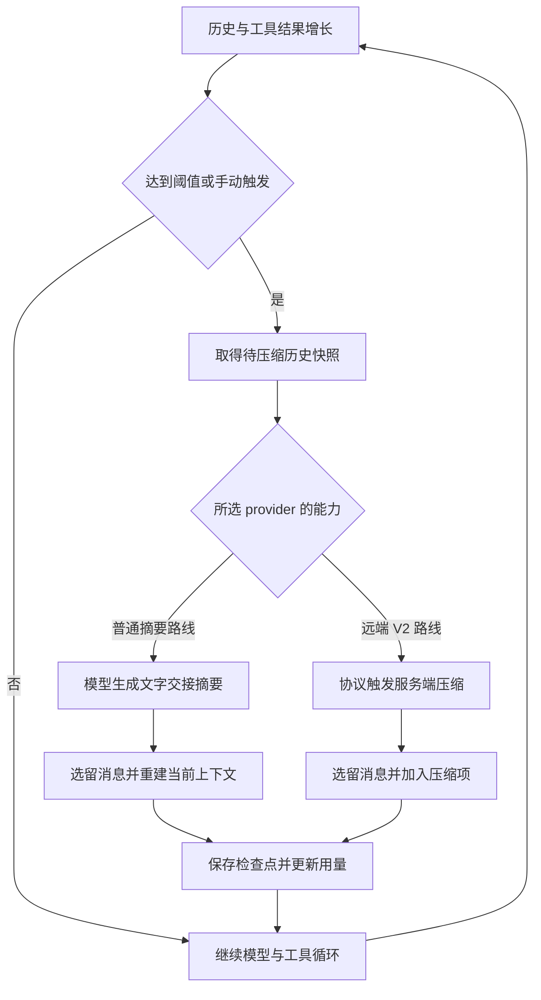

# 借鉴 Codex 的上下文压缩：源码核对与 CHI 设计讨论

日期：2026-10-21（Asia/Shanghai）。这是公开源码学习与方案讨论，不是已完成的 CHI 实现或已冻结的 OpenSpec。编码、真实 trial 与付费调用继续暂停；本文代码均为教学伪代码。

## 结论与证据范围

可以借鉴 Codex 的触发检查、摘要交接、上下文重建、检查点保存与历史版本校验。最适合 CHI 的起点是这些客户端工程原则；OpenAI 服务端的加密压缩项依赖对应模型和协议，不能直接作为 DeepSeek 的通用组件。

本轮读取的是 OpenAI 官方公开仓库 `openai/codex`，固定提交 `c6e4438a5d5befe6c8e59b01b6534eb8f0792230`（2026-10-20）。只读参考副本位于忽略目录 `.coordination/upstream-reference/codex-compaction/`。它不构成竞赛运行依赖，也不能证明当前桌面应用的版本、每次会话所走路径或服务端内部算法。

官方文档先于源码查阅：已读取 Codex Prompting Guide 的 Compaction 节和 Codex Config Reference。前者明确推荐公开 Codex CLI 作为参考实现，并介绍 Responses API 的压缩项；后者列出自动压缩阈值、阈值作用范围、摘要提示和 provider 能力配置。配置项存在，不表示本机已启用某个值。

来源：[Codex 官方指南](https://developers.openai.com/cookbook/examples/gpt-5/codex_prompting_guide#compaction)、[官方配置说明](https://developers.openai.com/codex/config-reference)、[固定源码版本](https://github.com/openai/codex/tree/c6e4438a5d5befe6c8e59b01b6534eb8f0792230)。

## 压缩到底改变了什么

模型每次只能使用本轮实际输入的上下文。压缩把旧历史换成较短的继续工作依据，再用于后续请求；它不会修改模型权重，也不会自动修改工具维护的业务状态。磁盘档案、模型本轮上下文和业务系统记录分别管理。

可把文字摘要理解为交接班记录：做了什么、哪些结论有依据、哪些约束仍然有效、还缺什么、下一步先做什么、原文在哪里。提示中的“另一个 LLM 继续”也不要求多 Agent 或换模型；同一 Agent 后续请求可以在新窗口继续。

下面是两类摘要路线的简化图，省略错误恢复、特殊 token-budget 功能分支和具体消息编码：



## 何时压缩：程序检查，不只靠模型提醒

公开配置包含：

- `model_auto_compact_token_limit`：自动压缩的 token 阈值；未设置时采用模型默认。
- `model_auto_compact_token_limit_scope`：可以按完整活跃上下文计数，或按当前窗口前缀之后的增长计数。
- `compact_prompt`：普通摘要提示的覆盖配置。
- `model_providers.<id>.capabilities.remote_compaction`：是否支持远端 V2；仍受模型和功能设置约束。

`session/context_window.rs` 计算活跃上下文、作用范围内 token 数、阈值和模型有效窗口上限；完整窗口上限独立于阈值作用范围。`session/turn.rs` 在新一轮采样前及需要继续的循环中检查并处理压缩；还有按配置处理轮结束的路径。不是每调用一次工具就自动总结，也没有证据支持“所有 Codex 都固定到某个百分比压缩”。

该版本源码还留有 TODO：普通 pre-turn 检查发生在新输入与上下文更新入历史前，对即将进入的内容应进一步做提前估算。因此不能把它描述成已精确预判所有下一请求长度。

源码：[窗口计算](https://github.com/openai/codex/blob/c6e4438a5d5befe6c8e59b01b6534eb8f0792230/codex-rs/core/src/session/context_window.rs#L53)、[循环检查与切换](https://github.com/openai/codex/blob/c6e4438a5d5befe6c8e59b01b6534eb8f0792230/codex-rs/core/src/session/turn.rs#L665)、[路线选择](https://github.com/openai/codex/blob/c6e4438a5d5befe6c8e59b01b6534eb8f0792230/codex-rs/core/src/session/turn.rs#L1514)。手动 `/compact` 是 CLI 功能；没有在当前对话实际执行它。

## 普通摘要路线：可移植的核心设计

这里的“普通/本地”是指由客户端组织摘要和重建，不表示离线、免费或无需模型 API。

`compact.rs` 的主要过程是：

1. 克隆当前历史，追加专门的摘要要求。
2. 通过模型客户端请求摘要；该路径构造的摘要请求没有配备业务工具。
3. 请求成功后取得文字摘要，加入表明它是接续工作摘要的前缀。
4. 选留一部分真实用户消息，再加入摘要。
5. 从当前会话重新构造规范上下文，安装新历史并重新计算用量。

默认摘要提示要求包含四类内容：当前进展与关键决策、重要上下文/约束/用户偏好、明确的后续工作、继续所需的数据/例子/引用。它关注恢复执行所需内容，而不是逐句缩写聊天。具体提示见 [公开模板](https://github.com/openai/codex/blob/c6e4438a5d5befe6c8e59b01b6534eb8f0792230/codex-rs/prompts/templates/compact/prompt.md)。

选留消息也有程序逻辑。该固定版本普通路线的用户消息预算为约 20,000 token，按近到远挑选，必要时裁剪，然后恢复原顺序；不是保证全部用户消息或近期全部工具原文永久保留。该常量只属于这份实现，不是 CHI 的待采用参数。

当前规范上下文通过 `build_compaction_replacement_history` 重建；摘要不是后续请求的唯一依据。摘要可能遗漏，约束和工具契约也可能改变，所以重要运行信息需要有独立来源。

错误处理同样存在：摘要请求本身超窗口时，该普通路线会逐步移除历史开头后重试；传输失败有有限重试，某些预算/响应错误直接返回。这是最后的恢复手段，不能把它解释为语义无损，也不建议 CHI 把删旧消息作为常规可靠性保障。

源码：[摘要请求与错误处理](https://github.com/openai/codex/blob/c6e4438a5d5befe6c8e59b01b6534eb8f0792230/codex-rs/core/src/compact.rs#L264)、[重建历史](https://github.com/openai/codex/blob/c6e4438a5d5befe6c8e59b01b6534eb8f0792230/codex-rs/core/src/compact.rs#L91)、[选择用户消息](https://github.com/openai/codex/blob/c6e4438a5d5befe6c8e59b01b6534eb8f0792230/codex-rs/core/src/compact.rs#L701)。

## 远端 V2：模型和协议共同提供的能力

在所核对版本中，普通路线之外还存在远端 V2。客户端在历史末尾加入 `CompactionTrigger`，通过 Responses 流请求压缩，并等待完成事件。返回必须包含恰好一个 `Compaction` 项；客户端再组合保留消息、压缩项与当前上下文。

这与公开指南介绍的“压缩项包含加密内容，后续请求继续携带”的概念一致。但所读 V2 客户端使用的是 Responses 流触发，不能把它直接画成每次固定调用公开 `/responses/compact` REST 接口。公开 API 和 Codex 当前源码的具体接入方式应区分。

加密项如何在服务端编码、具体保留了哪些内部表示，无法从这些客户端源码确定。不能说它只是普通 JSON 摘要、保证无损，或能复制给 DeepSeek 使用。

该版本 V2 的选留消息预算是约 64,000 token，保留逻辑主要针对真实用户/部分钩子消息，另有条件保留的客户端 developer 消息、工具输出和 Agent 消息。不能概括为“所有旧工具消息全部保留”或“所有路径都仅留下最后 N 轮”；这是模型/功能相关的具体实现。

源码：[V2 请求构造](https://github.com/openai/codex/blob/c6e4438a5d5befe6c8e59b01b6534eb8f0792230/codex-rs/core/src/compact_remote_v2_attempt.rs#L167)、[等待与校验压缩项](https://github.com/openai/codex/blob/c6e4438a5d5befe6c8e59b01b6534eb8f0792230/codex-rs/core/src/compact_remote_v2.rs#L375)、[构造 V2 历史](https://github.com/openai/codex/blob/c6e4438a5d5befe6c8e59b01b6534eb8f0792230/codex-rs/core/src/compact_remote_v2.rs#L480)。

另有 `TokenBudget` 功能分支调用窗口重置逻辑，本轮未完整核对，不把它混同成普通摘要，也不声称只有上述两种全部实现路径。

## 为什么需要检查点和历史版本

`Session::replace_compacted_history` 保存替换历史、窗口标识、响应标识及恢复元数据，并持久化 `Compacted`、世界状态与 turn context 等检查点内容。恢复时可以使用已产生的压缩历史。这里只确认检查点的代码路径，不保证所有模式/崩溃情况下原始载荷都已完整保存。

启用相应功能且 provider 支持时，还可以后台准备压缩。后台请求取得历史前缀快照；主流程继续工作。安装时检查历史代次、前缀长度、模型/压缩兼容信息等，再把当前未压缩的后缀保留下来。过期候选不能直接覆盖新历史；后台结果即使最终未采用，已经完成的调用也会消耗用量。

例如：后台对前 20 条记录做摘要，主流程又收到第 21 条“本次申请已受理”。安装时必须保留第 21 条；不能只用旧摘要把这次新观察覆盖掉。数字只是说明前缀与后缀的教学例子，不是 Codex 配置。

源码：[后台准备与候选检查](https://github.com/openai/codex/blob/c6e4438a5d5befe6c8e59b01b6534eb8f0792230/codex-rs/core/src/session/async_compaction.rs#L52)、[替换历史与保留后缀](https://github.com/openai/codex/blob/c6e4438a5d5befe6c8e59b01b6534eb8f0792230/codex-rs/core/src/session/mod.rs#L4246)、[持久化检查点](https://github.com/openai/codex/blob/c6e4438a5d5befe6c8e59b01b6534eb8f0792230/codex-rs/core/src/session/mod.rs#L4409)。

## 对 CHI 的建议：先借工程原则

这些是我们的候选设计，不是上述 Codex 源码已经替 CHI 实现的能力：

| Codex 中可参考的设计 | CHI 中拟采用的简化形式 |
| --- | --- |
| 用量与阈值检查 | 记录真实请求大小；按选定模型/接口设置输入预算并预留输出空间 |
| 继续任务所需的摘要 | 角色与目标、关键证据、缺口、已执行动作、下一步和原文位置 |
| 重建当前规范上下文 | 重新加入任务约束、实际工具契约与当前进度；不只传摘要 |
| 检查点和历史版本 | 保存原始证据与替换依据，确认对应版本再采用 |
| 后台压缩 | 首版先不加并发复杂度，等同步流程与成本有证据后再评估 |
| 加密压缩项 | 仅在目标 provider/模型实际支持时使用；不能假定 DeepSeek 可接收 |

对我们的医院侧任务，实际 ID、工具核实的状态、来源引用和结果未知的写操作，建议由程序维护明确字段。模型摘要可以解释关联与计划；不能自由改写这些字段。只能确定性检查部分不变量，不能因此保证摘要所有语义正确。

教学示意，以下是我们拟设计的进度记录，不是官方 schema 或真实轨迹：

```json
{
  "case_id": "<实际查询取得的 ID>",
  "last_write": {
    "operation": "submit_authorization",
    "outcome": "unknown",
    "reason": "timeout",
    "evidence_ref": "<对应工具调用记录位置>"
  },
  "next_step": "查询同一申请，核实本次提交效果"
}
```

用户已正确解释：服务端可能已提交，只是网络等原因让 Agent 没收到结果。更精确的记录仍是“超时，结果未知”；不能写成已经失败，也不能仅由摘要更新成成功。

## 教学伪代码：把压缩嵌入循环

下面将复杂实现缩成一条同步路径，帮助理解控制关系。函数名是概念占位，没有创建这些 API、运行代码或接入模型；不应原样交执行器当作可运行方案。

```python
async def prepare_next_input(history, progress, adapter, budget):
    current = adapter.build_input(history, progress)
    if estimate_tokens(current) < budget.compact_at:
        return current

    # 先验证所选协议允许这种历史缩减/断点继续。
    adapter.require_checkpoint_support()
    snapshot = history.snapshot_at_completed_tool_boundary()
    archive_originals(snapshot)

    summary = await summarize_for_continuation(
        snapshot,
        keep=("进度", "约束", "待办", "证据位置", "不确定性"),
    )
    candidate = adapter.rebuild_input(
        task=current_task(),
        tools=current_tool_contracts(),
        protected_progress=progress,
        summary=summary,
        recent=snapshot.recent_complete_exchanges,
    )
    check_known_facts(candidate, progress)
    adapter.validate_protocol(candidate)
    require_input_budget(candidate, budget)
    return install_checkpoint_if_current(snapshot.version, candidate)
```

关键点是：摘要成功后还要重建、核对、保存和采用；不应拿到一段短文字就无条件清空历史。`check_known_facts` 只能核对已明确表达的字段/冲突，不能凭空证明摘要完整。历史版本过期、协议不允许、摘要无效或仍超限时，应走有界恢复/停止，不反复消耗摘要调用。

DeepSeek 接入仍需先验证：当前官方思考模式携带 `tools` 时要求回传历史 `reasoning_content`，不能无条件裁掉；具体型号、接口、SDK 是否允许按上述检查点继续尚未实测。这段伪代码的适配层检查不能省略，也不意味着必须购买 OpenAI API。来源：[DeepSeek 官方说明](https://api-docs.deepseek.com/guides/thinking_mode/)。

## 后续如何判断是否值得实现

先取得真实基线中的请求长度、用量和失败轨迹，再决定自动压缩是否有必要。首版候选验收关注：

- “提交超时/未知”压缩后仍未知，实际 ID 和证据引用保持一致。
- 摘要不会触发已执行写操作的重放；继续时查询同一申请。
- 工具往返关联和 provider 额外字段合法，关键原文可按引用读回。
- 过期摘要不能覆盖新结果；恢复检查点后继续正确任务。
- 记录压缩前后请求大小、额外调用、耗时、预算与失败原因；不凭输入变短就声称总费用必然降低。

这些是未来实现的验收方向，当前未执行测试或真实请求，也不报告竞赛成功率提升。用户尚未逐项确认采用本研究中的设计；下一步仍是讨论并在冻结 OpenSpec 后实现。

理解问题已收到回答：用户能说明不能用旧摘要覆盖整个进度，否则会丢失新事实，并复述历史版本/前缀检查和后续消息保留。概念已能说明，实际实现与恢复未实践。用户随后要求回到项目前期工作，后续接上 [首轮开发准备](development-preparation-2026-10-21.md)，不把继续学习压缩设为开发前提。
