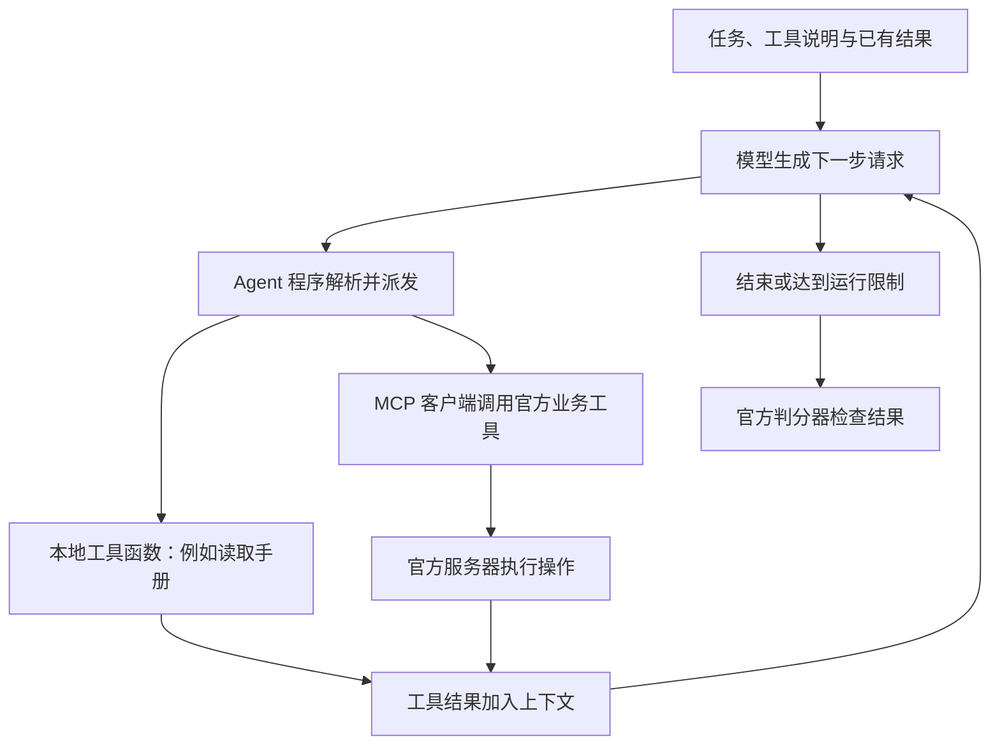

# 开发讨论：先接通官方环境，再用证据改进 Agent

日期：2026-10-21（Asia/Shanghai）。本轮是方案讨论和源码讲解，没有恢复编码、派发实现任务或运行付费评测。以下是建议的开发顺序；模型、harness、预算和后续改进尚未冻结。

同日最新取舍：用户不为当前本地官方判分开通 Anthropic，先验证环境和无评分的真实 Agent 执行，最终私有评分交主办方。下文最初的“先取得官方分数再改进”顺序按 [开发准备](development-preparation-2026-10-21.md) 调整；无评分执行不等于已通过任务，部分 Claude 模拟对话的本地验证也须记录依赖缺口。

## 要交付的系统

开发能在 CHI-Bench 官方环境中自主完成任务的参赛程序。起步任务为 `pa_t018_t018_o001_p01_new_referral_provider`，用于理解和调试；后续用其他公开任务检查通用性，并逐步覆盖比赛的三个领域。

| 部分 | 职责 | 我们的工作 |
| --- | --- | --- |
| 官方环境、业务 MCP 工具、判分器 | 提供病例与业务状态、执行业务操作、判断任务结果 | 按官方契约接入，保留原始评分证据 |
| harness | 在比赛容器中安装/启动 Agent，传入任务和连接信息，收集运行记录 | 优先复用合适的官方接入；需要时做薄适配 |
| Agent 执行程序（runner） | 组织模型、工具和上下文，驱动工具交互与停止 | 先运行参考实现，再按真实失败决定修改位置 |
| 模型 API | 根据任务、工具描述和历史结果，生成下一步工具请求或最终输出 | 固定实际服务商、模型标识、接口和使用限制 |
| 实验与交付层 | 固定配置，组织运行，汇总证据，支持复现 | 修复现有候选，建立可信的运行入口和记录 |

这里的 harness 是比赛接入概念，不能与用户用于写代码的 DeepSeek Harness 客户端混为一谈。实现执行器使用 DeepSeek，也不意味着参赛 Agent 必须调用 DeepSeek 模型。

官方允许自定义模型或 harness，接入方式见 [官方扩展文档（固定版本）](https://github.com/actava-ai/chi-bench/blob/4444a07fa68a4f1623f841a292a54e284fc8e7f7/docs/extending.md)。下面采用官方 SDK runner 作为已核对的教学例子，不表示已选定该技术栈。

## 先理解一轮工具调用



模型生成工具调用请求，实际副作用由工具实现执行。Agent 程序负责把两者连起来，并维护结果与后续调用。MCP 是程序连接外部工具的一种协议；`tools/list` 用于发现工具及其输入契约，`tools/call` 传入工具名和参数，服务器返回结果或错误，见 [MCP 工具规范](https://modelcontextprotocol.io/specification/2025-11-25/server/tools)。本地函数工具不必经过 MCP。

官方源码中可以核对到以下路径：

| 源码与符号 | 已确认的作用 |
| --- | --- |
| `openai_agents_harness.py`：`OpenAIAgentsHarness.run`（207 行起） | 获取 MCP 地址和配置，通过 `exec_as_agent` 启动 runner |
| `openai_agents_runner.py`：`run_agent`（637 行起） | 创建 MCP 连接，注册本地工具，构建 Agent，并调用 `Runner.run` |
| `openai_agents_local_tools.py`：`_make_fs_read`（99 行起） | 声明读文件工具的参数，注册回调；回调解析参数并执行 `Path.read_text` |

这些文件固定于官方提交 `4444a07fa68a4f1623f841a292a54e284fc8e7f7`；只读学习副本及来源清单位于忽略目录 `.coordination/upstream-reference/learning/`，三个文件的 Git blob 指纹均已核对。没有安装或执行这些源码；也尚未跟进 SDK 内部的调度实现，调用链讲解止于已核对接口。

例如，下面是根据真实工具契约写的**概念请求，不是实际模型输出或运行记录**，也不代表任何特定服务商的完整网络报文：

```json
{
  "name": "local-fs-read",
  "arguments": {
    "path": "/workspace/skills/managed-care-operations-handbook/SKILL.md",
    "offset": 1,
    "limit": 40
  }
}
```

模型选择这个动作；运行程序派发到注册回调；回调实际读取文件并返回内容；模型收到内容后继续决定下一步。医院侧业务操作则由 MCP 服务器执行。官方参考 runner 同时接入业务 MCP 工具和本地文件/终端等工具，不能把整个能力集合只算成任务文档中的 30 个业务方法。

工具调用返回成功、Agent 宣布完成、官方 reward 为 1 是三种不同事实。是否满足任务要求要看真实官方判分。

## 按什么顺序开发

| 阶段 | 开发内容 | 完成的证据 |
| --- | --- | --- |
| 1. 修复接入与就绪检查 | 审查原候选及返工意见；固定上游、补全任务 fixtures，验证 Docker、启动入口和角色工具 | 离线检查与失败路径可信；实时 schema 有实际来源；没有伪造执行结果 |
| 2. 取得单任务基线 | 用选定的内置 Agent、模型与 judge 配置，在明确预算内运行一次 | 原始 reward、scorecard、轨迹、运行身份及资源记录齐全；有效 0 分也是基线，无判分则仍未知 |
| 3. 做一个可比较的改进 | 从真实失败中选一类问题，例如手册查阅、遗漏校验、错误恢复或停止判断 | 改动前后在相同任务、模型和可比预算下对照；保留失败与回退证据 |
| 4. 扩展任务与可靠性检查 | 引入其他公开任务、三个领域的代表任务；预算允许时重复运行和并发 | 说明哪些任务参与了开发；另留未用于调试的任务检查泛化；结果与成本真实可追溯 |
| 5. 冻结参赛材料 | 整理程序、依赖、模型配置、Writeup 和技术报告 | 按官方环境能复现；报告主张对应实际证据；提交前复核规则 |

阶段 1、2 继续使用现有 OpenSpec 变更 `bootstrap-baseline`，不另建第二套基线。阶段 3 再提出独立改进变更；现阶段不提前指定 LangGraph、多 Agent、向量数据库或网页界面。

后续自己的工程贡献应明确到实际设计与实现，例如上下文组织、业务阶段检查、工具错误恢复或实验基础设施，并由实验证明作用。官方工具和评测器的能力不能当作自己的实现成果；简单增加框架也不等于提高任务成功率。

## 还需要确定的配置

- **参赛模型与接口**：实际可计费使用的 API、模型标识、tool calling 兼容性。客户端已登录不能代替 API 可用性验证。
- **基线 harness**：先选与模型接口兼容且可追踪的官方接入；通过一次实际连接验证后再冻结。
- **judge**：默认通过原生 API 凭据运行，但固定源码也支持已登录 Claude Code/OAuth；实际可用认证、指定模型与参数须分别验证。参见 [认证更正](judge-access-options-2026-10-21.md)。
- **预算**：Agent 与 judge 分别估算，先明确单次及本轮累计上限。没有实测前不承诺精确费用或一周成绩。

2026-10-21 用户补充的 API 状态（用户报告，尚未发请求验证）：

| 服务商 | 当前资源 | 规划含义 |
| --- | --- | --- |
| DeepSeek | 约 25 元人民币余额 | 优先考察作为参赛模型的接入；若写代码的执行器使用同一计费账户，须合并核算消耗 |
| Gemini | 免费额度及约 10 美元额度 | 保留为可选运行模型或后续对照；具体可用型号、限额及该额度对当前 API 的抵扣范围尚未核实 |
| Claude 判分访问 | 用户未开通原生 API，Claude 只有免费账号，没有付费订阅 | 原生 API 或 Code/OAuth 均未配置验证；Gemini/DeepSeek 余额不能直接替代其授权 |

官方 [扩展文档](https://github.com/actava-ai/chi-bench/blob/4444a07fa68a4f1623f841a292a54e284fc8e7f7/docs/extending.md) 明确保留原生 Anthropic 凭据给 judge，并将 Agent 的代理或模型配置限定在 Agent 进程。可先规划不调用模型的就绪检查；完整评分前须解决 judge 的访问和预算。不能静默改用 Gemini/DeepSeek 判分并当作官方结果，也不能用替代判分宣称通过。

同日源码更正：上述文档的 API Key 路径并非全部实现，判分器还保留 Claude Code 登录/OAuth fallback，Docker/Modal 均有 token 传递。用户只有免费 Claude 账号，目前不具备该订阅路径。源码也有不启用语义 judge 的部分确定性检查函数，适用范围与集成待验证；详见 [判分方式核对](judge-access-options-2026-10-21.md)。

可用余额不是已授权的运行预算。首轮先验证必要接口，再在明确的调用与费用上限内安排单任务，不承诺当前余额足够覆盖整个项目。DeepSeek 只是优先接入候选，具体模型、harness 以及费用上限均未冻结。当前不要求用户立即充值或开通新服务，也不因此恢复编码或付费运行。

密钥只在本机配置，不在聊天或公开材料中传递。上述配置确定后，再把第一阶段任务包交给 DeepSeek 实现。

## 官方环境与 harness：实际实现怎样连接

用户进一步要求解释这两个官方部分。以下核对固定于提交 `4444a07fa68a4f1623f841a292a54e284fc8e7f7`，属于源码与配置阅读，没有启动容器或产生真实运行记录。

### 官方业务环境

一次普通独立 trial 由 Harbor 调度环境，为任务准备新的容器和初始状态。官方单镜像启动脚本通过 `CHI_BENCH_TASK_ID` 找到该任务的 fixtures，调用 `chi_bench.bootstrap` 初始化运行时，再启动 `cb serve`，等待 HTTP 健康检查和三个 MCP 服务实际接受 `initialize` 后才继续。不同运行后端的具体布局可能不同；这里核对的是单镜像启动路径，不能用它替代未来 Docker 实测。

实现分为几层：

| 层 | 实际实现 | 作用 |
| --- | --- | --- |
| 初始世界与上下文 | `bootstrap.py`、`core/context.py` 的 `ServiceContext` | 加载任务定义，初始化/重置世界状态，组织各业务服务及工作目录 |
| 业务逻辑 | `services/chart.py`、`services/auth.py` 等 Python 服务 | 查询病例和医嘱，检查操作条件，生成提交记录，更新业务状态 |
| 工具入口 | `mcp/server.py` 的 `build_provider_mcp` | 把允许的医院侧服务方法注册为 FastMCP 工具；保险方和照护管理另有入口 |
| HTTP 入口 | `server/app.py` 的 FastAPI 应用 | 提供业务服务的 HTTP 路由；MCP 注册路径直接绑定服务方法，不必假设每个工具都额外调用一次 REST |
| 持久状态 | `core/store.py` 的 `WorldStore`，以及工作目录/FHIR 访问层 | SQLite 保存业务资源与审计，工作目录保存文件；病例查询也使用 FHIR 资源访问抽象，不把所有数据简化成一张表 |

`WorldStore` 明确创建 `provider_world.sqlite`、`payer_hidden.sqlite`、`audit.sqlite`。`save_resource` 用 SQLite 写入/更新资源后提交事务；`append_audit`、`append_transition` 等分别保存操作和状态变化。它们是模拟环境内部实现，Agent 应通过获准的业务工具操作，不能直接读取隐藏数据库或评分资料。

我们选中的任务在 `task.toml` 声明医院侧 MCP 地址为 `http://localhost:8020/mcp`。公开参考列出的 8 类 30 个业务方法，与该固定版本 `mcp/catalog.py` 的白名单一致；源码还支持额外 include/exclude 配置，最终实时 schema 仍待实际连接确认。

以注册 `chart.search_patients` 为例，已核对的绑定链是：

1. `register_all_services` 把 `ChartService(ctx)` 挂到 `ctx.chart`。
2. `ServiceContext.provider_services()` 把名称 `chart` 映射到该对象。
3. `build_provider_mcp` 根据白名单选择 `search_patients`，将该绑定方法交给 `mcp.tool(...)` 注册。
4. 请求经 MCP 库分派后，实际执行 `ChartService.search_patients`。该方法查找任务范围的 FHIR Patient 等资源，做筛选并返回结果；它还写入审计。

MCP 库内部的协议分派没有逐行阅读，本轮调用链停在已核对的工具注册和回调边界。

写操作同样会改变世界。例如 `AuthService.submit_authorization`（408 行起）实际会验证渠道、读取案件和规则、拒绝当前状态不允许的提交、保存 `SubmissionPacket`、更新并保存 case、记录审计，最后返回结果。保险方 AUTO 模式会继续模拟评估；其他模式可进入待保险方处理流程。不能据此认定所选任务一定会进入某个终态。

因此，模型生成“已提交”的文字，与业务服务实际保存了合法提交，是不同事实。

### 官方 harness

用已核对的 `OpenAIAgentsHarness` 举例：它继承 Harbor 的 `BaseInstalledAgent`，实现安装、启动和运行后记录三个接入步骤。harness 接收 Harbor 提供的 environment，并通过环境执行接口在 trial 环境安装/启动 Agent；真正驱动模型循环的是被启动的 runner。不能把 harness、runner 和模型当成同一个对象。

| 接入步骤 | 真实符号 | 做了什么 |
| --- | --- | --- |
| 准备依赖 | `install`（195 行起） | 在环境内指定的 Python 虚拟环境安装固定 SDK 版本 |
| 取得任务与配置 | `run`（207 行起） | 接收 instruction、environment、context，从 `self.mcp_servers` 取地址；缺地址直接报错 |
| 准备模型接口 | `_resolve_routing`、`run` | 解析模型标识、API 地址和凭据路由，传入轮数等运行设置 |
| 启动 Agent | `exec_as_agent`（280 行附近） | 把 instruction 写入临时文件，执行 runner 模块，传入任务文件和 MCP 地址，记录标准输出/错误 |
| 收集结果 | `populate_context_post_run`（299 行起） | 读取 runner 的结果与 trace，回填可获得的用量，并生成统一轨迹格式；它不负责判断任务是否通过 |

被启动的 `openai_agents_runner.py` 在 `run_agent` 中创建 `MCPServerStreamableHttp`，同时注册本地文件等工具，构建 Agent，并调用 `Runner.run`。参考实现的模型执行由 SDK 驱动；SDK 内部完整调用循环尚未逐行核对。

所以，优先复用官方接入意味着先复用环境启动接口、配置传递和日志收集；后续仍可改变 Agent 的提示、上下文组织、工具处理或执行策略。参赛模型和该参考 harness 尚未冻结。

### 核对范围与来源

- [单镜像启动脚本](https://github.com/actava-ai/chi-bench/blob/4444a07fa68a4f1623f841a292a54e284fc8e7f7/docker/entrypoint.sh)、[初始化入口](https://github.com/actava-ai/chi-bench/blob/4444a07fa68a4f1623f841a292a54e284fc8e7f7/src/chi_bench/bootstrap.py)。
- [服务注册](https://github.com/actava-ai/chi-bench/blob/4444a07fa68a4f1623f841a292a54e284fc8e7f7/src/chi_bench/services/__init__.py)、[医院侧 MCP 注册](https://github.com/actava-ai/chi-bench/blob/4444a07fa68a4f1623f841a292a54e284fc8e7f7/src/chi_bench/mcp/server.py)、[角色工具白名单](https://github.com/actava-ai/chi-bench/blob/4444a07fa68a4f1623f841a292a54e284fc8e7f7/src/chi_bench/mcp/catalog.py)。
- [业务上下文](https://github.com/actava-ai/chi-bench/blob/4444a07fa68a4f1623f841a292a54e284fc8e7f7/src/chi_bench/core/context.py)、[WorldStore](https://github.com/actava-ai/chi-bench/blob/4444a07fa68a4f1623f841a292a54e284fc8e7f7/src/chi_bench/core/store.py)、[病例查询服务](https://github.com/actava-ai/chi-bench/blob/4444a07fa68a4f1623f841a292a54e284fc8e7f7/src/chi_bench/services/chart.py)、[提交申请服务](https://github.com/actava-ai/chi-bench/blob/4444a07fa68a4f1623f841a292a54e284fc8e7f7/src/chi_bench/services/auth.py)。
- [harness](https://github.com/actava-ai/chi-bench/blob/4444a07fa68a4f1623f841a292a54e284fc8e7f7/src/chi_bench/experiment/agents/openai_agents_harness.py)、[runner](https://github.com/actava-ai/chi-bench/blob/4444a07fa68a4f1623f841a292a54e284fc8e7f7/src/chi_bench/experiment/agents/openai_agents_runner.py)。

官方架构网页与该固定版本的实现有细节差异：网页写 HTTP 端口为 8010 并描述 `/fixtures` 链接，固定启动脚本实际使用 8023，且明确不创建该链接。本轮以实际源码为准；任务声明的医院侧 MCP 8020 地址一致。未启动模拟器、连接实时 MCP，或读取该题隐藏 expectations。

## 本轮学习与下一步

本轮聚焦两个概念：比赛接入与 Agent 执行循环的分工，以及工具调用的请求—执行—结果回传。材料已经过源码核对；真实 tool call 尚未发生，用户掌握程度待反馈。

理解问题：模型发出“读取手册”的工具请求后，谁实际打开文件？读取结果返回后，模型为什么还需要继续运行？

下一步先结合用户回答补讲，再确定基线模型、harness、judge 与预算；学习不构成暂停已授权工作的额外条件。最新实施状态和后续问题继续记录在 [学习约定](learning-agreement.md)。
