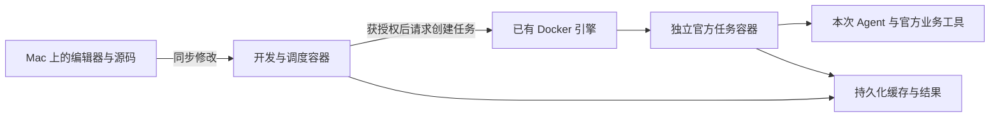

# Docker 内开发、调试与交付

更新：2026-10-25。用户要求项目依赖安装、下载、测试和运行都在 Docker 中完成，避免在 macOS 配置 Python/uv/Node 等项目环境。**当前由主代理协调两个 Luna High 子代理实现，主代理独立复验；候选 b7f8941 已通过当前 Python 3.13/aarch64 开发目标下的 D0 离线代码验收。** 80 项项目测试与 21 项独立补充检查通过，依赖锁/镜像可核对；官方 Python 3.12/其他架构、真实接入未验证。真实执行仍因缺核算依据阻断，A/B/C、参赛模型 API 和官方判分继续暂停。

## 工作边界

宿主机保留已有 Docker Desktop、编辑器、Git 与源码目录。主代理与子代理可编辑绑定到容器的源码，通过 Docker 命令在开发容器执行检查；不依赖 Antigravity，也不假定编辑器已附加远程容器。项目的 Python、uv、OpenSpec CLI（需要时）、测试工具、依赖安装和资料下载进程均运行在容器中。子代理的文件写入权与合成证据目录分开安排，详见 [双 Luna 工作流](luna-subagent-workflow.md)。

镜像、缓存和卷仍占用这台 Mac 的磁盘，由 Docker 管理。源码与允许导出的结果需要持久保存；“容器内执行”不表示不产生本地文件，也不表示所有资料都应烘焙进镜像。

## 两类容器的职责

| 容器 | 职责 | 版本和边界 |
| --- | --- | --- |
| 自有开发/调度容器 | 依赖安装、下载固定源码与资料、OpenSpec 检查、离线测试，以及获授权阶段的任务调度 | Python 首选 3.13，依赖验证后锁定小版本；环境存于镜像/卷，不在宿主机源码挂载中生成 macOS 环境 |
| 官方任务容器 | 一个 trial 的 Agent、模拟业务服务、角色 MCP、独立任务世界与适用的判分阶段 | 固定上游当前 Dockerfile 使用 Python 3.12；保持官方环境与工具契约，记录实际镜像身份 |

两者由已有 Docker Desktop 的引擎管理。A 阶段优先验证由调度容器调用该引擎创建并列任务容器的方式；D0 的开发/离线测试容器不需要任务调度权限。具体 Docker API/CLI、挂载与清理方式仍须按固定上游验证，不将这张设计图当作已运行证据。

自有开发环境与官方任务镜像中的解释器分别记录。固定提交的 `pyproject.toml` 声明 `requires-python = ">=3.12"`，但官方 Dockerfile 同时固定 `python:3.12-slim` 并包含 `python3.12/site-packages` 路径；不能只改 FROM 标签就宣称完成 3.13 迁移。将在官方容器执行的自有代码，须在该目标环境内验证。Docker 本身不替代依赖兼容性检查。

## 持久化、路径与资料

- 源码绑定项目目录，容器重建后保留代码；依赖环境放在容器路径或 Docker 卷，避免被源码挂载遮蔽或写回宿主机 `.venv`。
- 新下载、依赖缓存与大体积数据优先使用 Docker 管理的存储；已有本机手册可在授权范围内只读复用，不要求重新下载或删除。具体任务数据采用卷还是绑定目录，以官方入口的实际挂载契约验证后确定，绑定时仅使用约定的忽略目录。
- 任务调度需要同时核对容器内路径和 Docker 引擎看到的源路径；容器的私有 `/workspace` 目录不能直接冒充宿主机绑定源。日志也必须在任务结束、容器清理后仍可读取。
- 官方 harness 与 MCP 位于同一任务容器时，沿用其传入端点；跨容器调试时单独验证网络地址，不把另一个容器的 localhost 当成本容器的服务。
- API/Hugging Face 凭据运行时注入；不写 Dockerfile、构建参数、镜像层、锁文件或日志。原始任务轨迹和受限内容仍只保存在授权位置，不随 GitHub 文档上传。

## 交付镜像

我们可以选择 Docker 镜像加源码、依赖锁文件和运行说明作为交付方式。官方规则也允许带完整运行说明的源码包，Docker 是本项目选定的工程方式，不是新增的赛事强制条件。

固定官方 Dockerfile 会 COPY 手册和任务数据进入运行镜像。因此完整官方运行镜像与可交付的自有代码镜像必须分别审查；前者不能因为是 Docker 就直接发布或交给未获授权方。自有交付镜像只打包允许分发的代码和依赖，所需受限资料由有权限的运行方挂载或下载，不提交手册副本。D0 增加独立 `.dockerignore`/受控构建上下文；`.gitignore` 不代替镜像内容检查。

最终复现从干净镜像与已声明资源启动，不依赖开发容器里临时手装的包、Mac 的绝对路径或仅本机存在的依赖缓存。记录开发镜像、任务镜像、目标架构和实际依赖身份；当前 arm64 本机可用不等于最终目标架构已验证。

## 恢复后的验收顺序

1. D0：构建最小开发容器，在其中建立锁定依赖并运行既有包装代码的针对性离线测试；核对源码、环境与结果的持久化。镜像构建可下载依赖，离线测试本身不调用模型或启动官方任务世界。
2. A：在调度容器中补齐固定源码和完整数据，验证官方镜像、Docker 引擎连接、任务挂载、网络、实时 MCP 与任务清理。无评分入口仍须单独核实，不增加虚构 CLI 开关。
3. B/C：在上述容器工作流内完成模型工具往返及一次自主任务尝试，沿用合计 5 元预算、一次尝试和本地官方判分暂缓的原约定。
4. 最终交付：在约定目标环境复现干净启动，审查镜像内容与资源说明，准备 Writeup、私有程序包和技术报告。

## 已核对的来源

- [固定提交 pyproject.toml](https://github.com/actava-ai/chi-bench/blob/4444a07fa68a4f1623f841a292a54e284fc8e7f7/pyproject.toml)：通过 GitHub 连接器实际读取，Python 最低 3.12，包含适用于 3.13 的条件依赖。
- [固定提交 Dockerfile](https://github.com/actava-ai/chi-bench/blob/4444a07fa68a4f1623f841a292a54e284fc8e7f7/docker/Dockerfile)：实际读取，Python 3.12、固定解释器路径、任务及手册 COPY。
- [固定提交 entrypoint.sh](https://github.com/actava-ai/chi-bench/blob/4444a07fa68a4f1623f841a292a54e284fc8e7f7/docker/entrypoint.sh)：实际读取，依据任务 ID 选择世界与工具参考。
- [官方架构](https://www.actava.ai/benchmarks/docs/architecture)、[Kaggle 规则](https://www.kaggle.com/competitions/chi-bench/rules)。网页架构可能与固定源码有差异，以所选提交和实际观察为准。
- [Docker 绑定挂载](https://docs.docker.com/engine/storage/bind-mounts/)、[Docker 存储](https://docs.docker.com/engine/storage/)、[Python 容器开发指南](https://docs.docker.com/guides/python/)。
