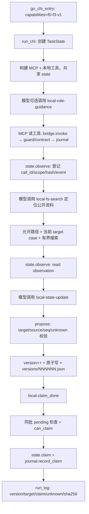

# F0–F3 面试版走读：来源、状态、完成与检索

建立：2026-11-01。对应合并后主线 `066c9ae`、实现候选 `5c1fa51`。本页是教学/面试讲解，不替代 [实现报告](../reviews/f0-f3-agent-capabilities-review.md)、[契约](../openspec/changes/agent-capabilities-f0-f3/design.md) 或 [审核状态](../reviews/REVIEW_STATE.md)。行号以当前主线为准，代码变动后可能漂移，优先按函数名检索。

## 1. 先放层次

| 层 | 管理对象 | 典型问题 | 本项目 |
| --- | --- | --- | --- |
| SDK Agent loop | 一轮轮模型决策与工具调用 | 下一步做什么 | `Runner.run()` + 官方 `SYSTEM_PROMPT` |
| B | 模型—工具传输契约 | 工具结果是否正确回传、call ID/用量是否一致 | `ChiGuard`、`ToolContract`、journal、MCP/HTTP |
| C | 一次任务尝试的生命周期 | 是否重复启动、资源是否清理 | `role_operator`/`go_chi_entry`、claim、world、cleanup |
| F0–F3 | 一次 run 内的业务状态、角色分支、资料定位 | 现在知道什么、还差什么、哪个写结果未知 | `TaskState`、`local-role-guidance`、`local-fs-search` |
| F5 最小前移 | 结束语义 | claim 是否等于完成 | `local-claim_done` 门禁 |
| journal/accounting | 证据与钱 | 请求、费用、未知、清理是否留证 | `ChiJournal`、账本 |

F0–F3 不是新的 runner，也不管理世界或 claim。它在 `run_chi()` 内部，和 MCP 工具、本地工具共用同一个 guard、contract、journal 和请求预算。C 管“这次尝试能不能开始、资源怎么收”；F0–F3 管“这次 run 里模型对业务知道什么、依据在哪”。

## 2. 代码阅读顺序

| 顺序 | 入口 | 负责什么 |
| --- | --- | --- |
| 1 | [`run_chi()` state 创建](../scripts/go_chi_runtime.py#L131) | 在 `logs/task-state/` 创建本次 run 状态 |
| 2 | [`MCPBridge`/`local_tools` 接线](../scripts/go_chi_runtime.py#L142) | 同一个 state 传给 MCP 和本地工具 |
| 3 | [`TaskState`](../scripts/go_chi_state.py#L121) | schema、观察、更新、持久化、claim 判断 |
| 4 | [`observe()`](../scripts/go_chi_state.py#L178) | 程序登记真实工具 observation |
| 5 | [`propose()`](../scripts/go_chi_state.py#L384) | 校验并应用模型提交的更新 |
| 6 | [`can_claim()`](../scripts/go_chi_state.py#L436) | 判断能否声明完成 |
| 7 | [`block_mutation()`](../scripts/go_chi_state.py#L428) | claim 后再写：拒绝并标记违规 |
| 8 | [`local-claim_done`](../scripts/go_chi_tools.py#L169) | 同批检查 + state claim + journal claim |
| 9 | [`local-fs-search`](../scripts/go_chi_tools.py#L307) | 路径/目标 case 校验 + 有界检索 |
| 10 | [`local-role-guidance`](../scripts/go_chi_tools.py#L284) | 返回版本化角色阶段 |
| 11 | [MCP observation 登记](../scripts/go_chi_mcp.py#L197) | MCP 工具成功后登记 |
| 12 | [`search()`](../scripts/go_chi_search.py#L56) | 有界搜索、单文件不可读语义 |
| 13 | [合成运行时测试](../tests/test_go_chi_capabilities_runtime.py#L99) | 正常闭环与失败路径 |

## 3. 正常主链



1. `go_chi_entry` 显式传 `capabilities="f0-f3-v1"`；`run_chi()` 在日志目录创建 `task-state/`。`capabilities=None` 时不创建状态，也不增加四个工具。
2. 同一个 `state` 传给 `MCPBridge` 和 `local_tools`。模型看到的是普通工具列表，不需要知道状态文件在哪。
3. 模型可先调 `local-role-guidance`，拿到 provider/payer/CM 的阶段、前置证据、动作候选、回读和停止条件。
4. 模型调 MCP 读工具。`MCPBridge.invoke()` 确认这是已接受批次里的调用，经 `ChiGuard`/`ToolContract` 校验，`journal.record_tool()` 留证，然后 `state.observe()`。
5. 模型调 `local-fs-search`。工具先走 `allowed_read()` 路径允许清单，再核对 workspace 路径是否属于当前 `target.case_id`，最后进 `bounded_search()`。
6. 模型调 `local-state-update`。`TaskState.propose()` 检查目标、来源、版本、未知项，全部通过才 `version += 1`，原子写当前文件和版本快照。
7. 模型调 `local-claim_done`。先看同一批里 claim 之后是否还有待执行工具；再看 open unknown 和写后回读；都通过才记录 claim，并调用原来的 `journal.record_claim()`。
8. run 结束时，`run_chi()` 做 claim 一致性检查，并把 state version/target/claim/`claim_violation`/open unknowns/`task_state_sha256` 写进 `run_log.txt`。

## 4. 来源与权威边界

面试官如果问“模型说完成了，程序怎么知道不是幻觉”，答案不是“程序理解业务”，而是“程序校验来源，语义仍标 model_report”。

`observe()` 只登记程序真正看到的东西：

```python
observation = {
    "seq": len(self.data["observations"]) + 1,
    "call_id": call_id,
    "tool": tool,
    "kind": kind,
    "effect": effect,
    "scope": scope,
    "arguments_sha256": _sha(arguments or {}),
    "result_sha256": _sha(result if result is not None else ""),
    "event": event,
    "round": round_number,
}
```

它不存工具正文，只存身份和 hash；正文仍在 journal/日志里。这样状态文件小，也不复制一份可能含敏感内容的正文。

模型能提交的字段只有 `facts`、`plans`、`gaps`、`target`、`latest_business_status`、`next_candidates`、`resolve_unknown`。

程序强制：

- `source_call_id` 必须存在，且 `event == "returned"`；`returned_error`、`refused`、`failed` 不能当“已观察事实”。
- `source_seq` 由程序填写，模型不能提供。
- 有 target case 后，来源 scope 必须是 `case:<target>` 或 `shared_public`；其他 case 返回 `chi_state_case_mismatch`。
- target case 未设定时，case scope 来源不能作为事实/状态，返回 `chi_state_target_required`。
- 最新状态只能由更晚来源更新；旧来源覆盖新状态返回 `chi_state_stale`。
- provider 的 patient 必须已绑定且不可改绑；未绑定返回 `chi_state_patient_unbound`。
- 写类工具失败登记 open unknown；只能由同目标、更晚的只读 observation resolve；不能直接改成成功/失败。

`propose()` 有事务式回滚：

```python
backup = json.loads(json.dumps(self.data))
try:
    ...
    self.data["version"] += 1
    self._persist()
except StateRefusal:
    self.data = backup
    raise
```

可纠正的模型错误返回 `REFUSED: <code>`；持久化失败才升级为 `GoFailure`，停止 run。

**可答**：程序不能判断“这个临床解释对不对”，但能判断“这句话有没有挂在本次真实观察上”。推断可以存在，但只能进 plans/gaps，不能冒充 facts。

## 5. 持久化与版本

`_atomic_write()` 的顺序：

```python
fd, temporary = tempfile.mkstemp(prefix=".task-state-", dir=path.parent)
with os.fdopen(fd, "wb") as handle:
    handle.write(raw)
    handle.flush()
    os.fsync(handle.fileno())
os.replace(temporary, path)
```

然后对目录 `fsync`，失败不影响主流程。`os.replace` 保证读者看到整份旧文件或整份新文件，不会读到半份 JSON。

状态两层：

- `task-state.json`：当前版本。
- `versions/NNNNNN.json`：每次成功更新保留的旧版本，只增不改。

上限：单文件 64 KiB，observations 256、facts 64、plans 16、gaps 32、unknowns 16、next 8。超过上限返回 `chi_state_limit` 或停止，不静默丢历史。

**为什么不用账本/数据库？**

- 账本管请求、费用、准入，schema 严格且要求历史字节不被改写；状态管业务认知，混进去会让“更新认知”和“重写账目”互相污染。
- 单次 run 的 JSON + 版本快照足够审计，不引入数据库依赖。
- 状态写失败就停止，不降级成“只在内存里记着”，避免日志看起来成功、实际没有证据。

**边界**：不是跨进程、跨主机数据库事务；进程崩溃后状态可能停在最后成功写入的版本，不能宣称自动恢复。F1 只承诺本次 run 内可追溯，不承诺崩溃续跑。

## 6. claim 门禁

`can_claim()`：

```python
open_unknowns = [item for item in self.data["unknowns"] if item["status"] == "open"]
if open_unknowns:
    return False, "completion_blocked_unknown:" + open_unknowns[0]["id"]
mutations = [item for item in self.data["observations"] if item["effect"] == "mutation"]
if mutations:
    last = mutations[-1]
    status = self.data["latest_business_status"]
    if status is None or status["source_seq"] < last["seq"]:
        return False, "completion_readback_required:" + last["call_id"]
```

再加两道：

1. `local-claim_done` 看同一批里 claim 之后是否还有待执行工具；有就返回 `completion_batch_pending:<id>`，避免“先 claim 再写”。
2. claim 之后再调度 mutation，`block_mutation()` 返回 `task_already_claimed_mutation_forbidden`，不执行写，并设置 `claim_violation=true`；`run_chi()` 最终以 `chi_claim_violation` 结束为 incomplete。

```python
def block_mutation(self, tool, kind):
    reason = self.mutation_block_reason(tool, kind)
    if reason is not None and not self.data.get("claim_violation"):
        self.data["claim_violation"] = True
        self._persist()
    return reason
```

防御层：`observe()` 记录到 mutation 时清空已记录 claim；如果其他路径绕过调度层，`run_chi()` 发现 journal `claim_done=True` 但 state claim 已空，会以 `chi_claim_invalidated` 拒绝完成。

**为什么不是把 journal 的 claim 改成 false？**

journal 是单调证据：记录“当时确实声明过完成”。之后发现新写，正确做法是让本次 run 失败/不完整，而不是回写历史把 claim 抹掉。否则审计上分不清“从未 claim”和“claim 后又反悔”。所以采用“拒绝写 + 标记违规 + run 失败”，保留历史字节。

**可答**：

- claim 只是模型声明，不等于业务成功，更不等于官方分数。
- 写后必须回读；有未知写必须查证；claim 后再写直接失败。
- 不是 exactly-once，只是“同一持久作用域内至多一次 claim/执行机会”的保守控制；中断后需要人工核查。

## 7. 指导为什么是工具

`go_chi_guidance.py` 给出 `chi-role-guidance-v1`，每角色 5–6 个阶段，字段是 goal/preconditions/actions/readback/stop_if，另有 invariants。例如 payer 明确写：

- 批准、部分批准、拒绝、补件、转 MD、P2P 都是合法分支；
- 文件存在不等于条件满足；
- MD 不是每个案子必经；
- finalize/deliver 后要回读。

为什么不直接改 `official.SYSTEM_PROMPT`？

- `ChiGuard` 要求 system 消息严格等于“官方提示 + 预算反馈后缀”；
- `ToolContract.validate_history()` 严格匹配完整工具批次；
- 改系统提示会同时改变请求契约、身份、B 和回归范围。

所以用工具返回，版本/hash 写进 `run_log`，请求契约不变。代价是模型可能不主动调用；这一点还没有真实模型证据，不能说“指导已经生效”。

**可答**：这是把策略变成可版本化、可审计的输入，不是用提示词硬编码答案。指导只给分支和检查点，不给 task ID 或期望结局。

## 8. 有界检索与“错误不是无匹配”

`local-fs-search` 有两层范围：

1. `allowed_read()`：handbook、当前角色 workspace、固定 instruction/tool_references；隐藏/verifier/judge/fixtures、符号链接拒绝。
2. target case：workspace 路径必须属于当前 `state.target.case_id`；target 未设定时拒绝对具体 case 目录搜索。

限制：400 个文件、单文件 2 MiB、累计 16 MiB、最多 20 条结果、片段 240 字符；超限返回 `truncated`/`omitted`，不静默截断。

单文件不可读的语义：

```python
if failed:
    if single_file:
        raise SearchRefusal("search_unreadable")
    skipped += 1
    unreadable += 1
    continue
```

工具层把 `search_unreadable` 映射成 `ERROR: search_unreadable`；目录不可读也报错；目录内个别文件失败计入 `unreadable_files`/`skipped_files`。

**为什么不能把损坏文件当 no_matches？** “文件里没有这个词”和“文件读不出来”是两种事实。前者可以作为“未找到依据”，后者只能说明证据不可用；混在一起会让模型误以为条款不存在。

**为什么不做向量库/RAG？** 当前只需要在已授权公开资料里定位并留来源，有界文本检索可审计、无新依赖、不产生可外发的派生索引。是否升级要看真实任务中“反复迷路/漏条款”的证据，不能为了功能数先上向量库。

## 9. 失败状态表

| 场景 | 结果 |
| --- | --- |
| 引用不存在的 call_id | `REFUSED: chi_state_source_unobserved` |
| target 未设定却引用 case 事实 | `REFUSED: chi_state_target_required` |
| 来源属于其他 case | `REFUSED: chi_state_case_mismatch` |
| 旧来源覆盖新状态 | `REFUSED: chi_state_stale` |
| 试图改绑 patient/case | `REFUSED: chi_state_target_locked` |
| patient 未绑定 | `REFUSED: chi_state_patient_unbound` |
| 用非读/非 returned 来源做状态 | `REFUSED: chi_state_source_not_read` |
| 超限 | `REFUSED: chi_state_limit` |
| 持久化失败 | `GoFailure: chi_state_persistence_failed` |
| 有 open unknown 时 claim | `REFUSED: completion_blocked_unknown:<id>` |
| 写后未回读 | `REFUSED: completion_readback_required:<call_id>` |
| 同批 claim 后还有工具 | `REFUSED: completion_batch_pending:<id>` |
| claim 后再写 | `REFUSED: task_already_claimed_mutation_forbidden` + run `chi_claim_violation` |
| 绕过调度层观察到 mutation | run `chi_claim_invalidated` |
| 检索路径越界/跨 case | `REFUSED: search_path_outside_allowlist` |
| 查询非法 | `REFUSED: search_query_invalid` |
| 单文件损坏/目录不可读 | `ERROR: search_unreadable` |

和 C 阶段一样：顶层 status 不等于主要错误。`run_log.txt` 的 `status/safe_error_code` 是本次 run 终态；state 里的 `claim_violation`/`unknowns` 是业务层证据；journal 的 claim/费用是账目层证据。三者不能混着读。

## 10. 证据与边界

- 全量 Docker：424 tests，2 个既有环境错误（缺 `anthropic`），8 skipped；新增 42 个测试。
- 定向：38 tests OK（state/search/tools/capabilities runtime）。
- 合成运行时走真实 SDK loop、`ChiGuard`、`ToolContract`、journal 和 `httpx.MockTransport`；不是只测纯函数。
- 外部 Gemini 首轮 Docker 复验发现 3 个阻断：claim 后跨轮写、跨 case 检索、单文件损坏伪装无匹配；返工后复审通过。
- 复审边界：仅离线静态/契约/Docker 合成；没有真实模型、真实任务、官方判分、临床评审。
- 所以能说的是“实现完成 + 合成离线自测通过 + 外部离线复审通过”，不能说“真实模型会用、业务有效、临床正确、官方分数通过”。

## 11. 面试 60 秒版

> 我在 CHI-Bench 项目里参与的是 Agent 接入和能力收口。F0–F3 解决的是模型在一次任务中对业务状态的组织和来源问题。程序只把真实发生的工具调用登记为 observation，模型提交事实和最新状态时必须引用这些 call_id；程序填 source_seq，拒绝旧来源覆盖新状态、错 case、改绑患者。状态写在 run 日志目录，原子写入并保留版本快照，不写账本。完成声明前检查 open unknown 和写后是否回读；claim 之后任何写都会被拒绝并让 run 以 `chi_claim_violation` 失败，避免先声明完成再写。规则检索只在允许目录和当前 case 内做有界文本搜索，单文件损坏明确报 `search_unreadable`，不伪装成无匹配。我们用合成 SDK/MCP 和 Docker 回归验证这些边界，真实模型和官方评分还没有跑。

## 12. 可能的追问

- **“模型不调用 guidance/state 怎么办？”** 目前是工具化，未强制；真实使用率未验证。可以在 F4/F5 评估是否需要在 instruction 层加显式引导，但那会改变请求契约，需重新审。
- **“状态会不会爆上下文？”** 状态有 64 KiB/条数上限，`local-task-state` 只返回摘要和最近 20 条 observation；完整上下文预算和压缩是 F4，尚未实现。
- **“进程崩溃后能恢复吗？”** 不能宣称自动续跑。状态可能停在最后成功写入的版本；journal/claim/账目仍是权威证据。跨进程恢复需要额外身份和副作用处理，未做。
- **“是不是 exactly-once？”** 不是。是同一持久作用域内至多一次 claim/执行机会的保守控制；中断后要人工核查，跨主机全局幂等未验证。
- **“临床正确性怎么保证？”** 不保证。程序只做来源、状态、机械检查；临床语义需要临床评审或官方 judge，当前 0 授权，不能自评。
- **“为什么 claim 后写要让整个 run 失败，而不是允许重新 claim？”** journal 的 claim 是单调证据，回写历史会破坏审计；当前选择 fail closed，保留原 claim 和 `claim_violation`，让本次 run 以 incomplete 结束。

## 13. 个人表述边界

这段讲的是项目机制。可以据实说明参与了范围、授权边界、审核和 AI 辅助后的源码学习；具体“独立编写/调试”的经历，等亲自改过一次、复现过一次再展开，不要把代理完成写成个人独立实践。
