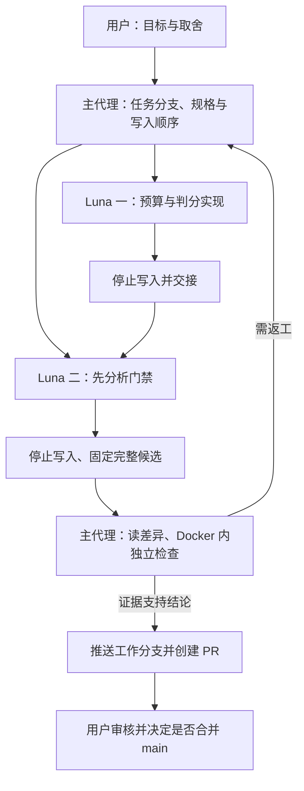

# 两个 Luna High 子代理怎样开发

更新：2026-10-25。用户明确选择 Codex 主代理协调两个 `gpt-6-luna` 子代理，推理强度均为 `high`，接续 `bootstrap-baseline/D0`。这是开发协作方式，参赛 Agent 的运行时模型与 5 元预算保持原约定。

## 你需要做什么

在当前 Codex 对话说明目标、边界和需要讲解的内容即可。主代理负责创建两个子代理、给任务、收集结果、返工和验收；不需要你另开两条普通对话或搬运回复。应用显示子代理活动时可以打开查看；需要调整方向或停止时直接告诉主代理。新对话先读取 AGENTS.md 及当前学习/审核摘要，再继续有界任务。

后续主代理先从最新 `origin/main` 建立 `codex/<任务名>` 工作分支，再派发实现；代码和文档均在该分支提交。独立检查后，主代理推送分支并创建目标为 main 的 PR，你在 GitHub 审核并决定是否合并。主代理不直接开发/推送 main、不代行合并或开启 auto-merge。子代理沿用已分配的任务分支，不自行切分支；共享文件仍须接力，分支不等于工作区隔离。

可复制的接续指令：

```text
继续 CHI-Bench 的 bootstrap-baseline/D0。使用两个子代理，模型都指定
gpt-6-luna，reasoning effort 为 high；不再交给 Gemini。
你负责规格、协调、独立审核、教学和 GitHub 存储。
先读当前学习/审核状态，保留现有改动，按文件所有权安排任务。
先创建 codex 工作分支，代码和文档都通过 PR 交我审核，不直接推 main 或自动合并。
共享文件串行修改，所有项目安装、测试、调试在 Docker 内完成。
只处理未决 D0 问题及受影响回归，不启动 A/B/C、参赛模型 API 或官方判分。
完成后给出候选身份、实际检查、未验证项，并结合真实代码讲解。
```

## 三个角色如何配合

| 角色 | 本轮分工 | 交付给谁 |
| --- | --- | --- |
| 主代理 | 创建任务分支、规格与写入顺序、独立检查/教学、显式暂存、推送并创建 PR | 用户审核并决定合并 main |
| Luna 一 | R2 累计预算/下一请求预留/停止决策；R3 trial 身份与异常判分；对应生产测试 | 主代理 |
| Luna 二 | R5 所选任务/provider/手册证据与模式支持的一致门禁；对应生产测试 | 主代理 |

本轮起点为 main 的文档提交 `35370ab5d9d20f03b1cb8e4fab60e2e220a24dd9`，开工时上次已审实现 c4b410a 尚未通过。技术标准沿用其未决 R2/R3/R5，不以更换实现者清空旧缺陷；历史复审保存在 35370ab。**本轮代码候选 `b7f894130df93ded69496576b83e6dcdcab7e56b` 已通过 D0 离线代码验收：主代理独立 80 项项目测试和 21 项补充检查通过**，见 [本轮独立验收](../reviews/bootstrap-baseline-d0-review.md)。后续开工仍重新记录实际 HEAD/差异，不能直接照抄本轮起点。

两个任务都会碰到 scripts/run_baseline.py，因此本轮并行读取和分析，**串行写共享文件**：Luna 一先实现 R2/R3；Luna 二先只读准备 R5，收到主代理的写入交接后才修改。新测试文件分别命名，避免同时维护同一份测试。主代理可同时编辑自己独占的协作文档。若以后确需同时改重叠文件，先隔离 worktree/checkout 与容器结果目录，合并后再复验；切换分支不能隔离同一工作区。



## 每个任务包必须包含什么

主代理给子代理的是精简任务包：目标、基线/当前状态、必读的规格和相关文件、允许修改的路径、验收行为、Docker 命令/证据位置、停止条件。子代理按需追踪实际调用者，不复制整段聊天，也不默认全量重读仓库。

子代理返回改动文件、关键入口、实际命令/退出结果、失败/未运行项和需要主代理决定的事情。不能只说“全部通过”。两个子代理都不递归创建代理，不自行切分支/push，不重置或全量暂存；主代理在同一任务分支统一处理 Git 和 PR，区分协作文档、实现候选和审核记录，用户保留合并决定。

## 为什么还要主代理审核

子代理的自测能帮助定位问题，但可能沿用自己实现中的错误假设。主代理要对照原规格，读取完整候选差异和必要调用代码，使用独立合成输入检查生产行为。比如本项目曾有 51 项原测试通过，但相反 config.json 被目录名覆盖的问题仍存在；测试数量不能替代这个具体行为的证据。

“两个子代理”不等于两人同时写同一文件；“High”是各子代理的推理设置，也不能保证实现正确。当前选择的是明确分工和闭环返工。不会承诺更少总 token、固定节约比例或更高通过率；分别观察实现耗时、返工次数和可见用量。只对已授权的开发任务使用这两个子代理，普通问答不默认启动它们。

## 模型与权限

本会话派发时显式指定 `model=gpt-6-luna` 和 `reasoning_effort=high`；无须为此在 Mac 安装依赖或配置模型 API Key，也不修改用户全局模型设置。若派发失败，报告实际错误，不能静默换成其他模型。每次派发记录请求设置与返回身份，不把文档中的配置当成已经启动。

子代理沿用当前会话的工具与沙箱权限，角色文字不会创造额外安全隔离；工具要求的权限仍按工具处理。项目 Python、uv、测试与调试在 Docker 内执行；宿主机用于编辑、Git 和 Docker 命令。测试不挂 docker.sock、不提供真实模型密钥；官方任务、评分和 A/B/C 继续暂停。

官方依据：[Subagents](https://learn.chatgpt.com/docs/agent-configuration/subagents) 说明显式请求、模型/推理设置、权限继承与并发写入注意事项；[GPT-6 Luna](https://developers.openai.com/api/docs/models/gpt-6-luna) 列出模型 ID 和支持的 high。本文的 R2/R3/R5 分工与串行写入是本项目的具体安排。

教学反馈：用户回答共享文件要接力是为“避免覆盖彼此改动，交接后再继续修改”，已能判断此具体风险；完整任务拆分、调度和工具实践未据此认定掌握。当前 D0 无代码返工待办；A/B/C、模型 API 与官方判分仍暂停，真实入口仍因缺可信核算数据阻断。
